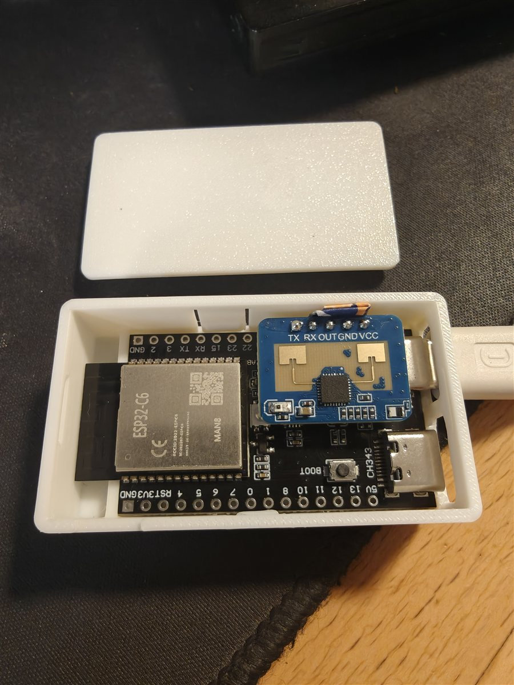
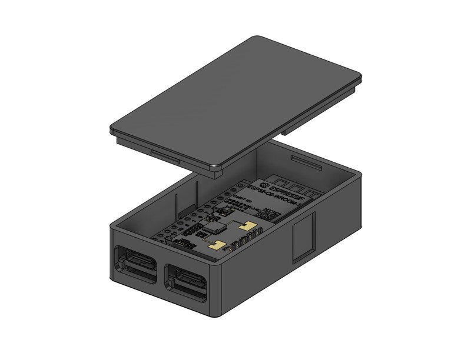

# mmWave presence sensor · HLK-LD2410C + nanoESP32-C6

*[Versión en español más abajo](#espanol)*

Human presence sensor for Home Assistant built from an **HLK-LD2410C** mmWave radar soldered straight onto a **nanoESP32-C6**, running **ESPHome**, with a 3D-printed enclosure (and optional wall mounts).

<p align="center">
  
  
</p>

## Hardware

| Component | Notes |
|---|---|
| nanoESP32-C6 | Dual USB-C board (silkscreen "nanoESP32-C6 V1.0") |
| HLK-LD2410C | 24 GHz mmWave radar |
| USB-C cable + 5 V power supply | |

### Wiring

The radar is soldered directly onto the ESP header, no wires:

| LD2410C | nanoESP32-C6 | Use |
|---|---|---|
| VCC | 5V | Power |
| GND | GND | |
| OUT | GPIO9 | Not used (GPIO9 is a C6 strapping pin) |
| RX | GPIO18 | ESP TX |
| TX | GPIO19 | ESP RX |

All data comes over UART at 256000 baud.

<p align="center"></p>

## Firmware (ESPHome)

There are two configurations:

| File | Link to Home Assistant |
|---|---|
| [`sensor-presencia.yaml`](sensor-presencia.yaml) | **Zigbee** (Zigbee2MQTT), no WiFi |
| [`sensor-presencia-wifi.yaml`](sensor-presencia-wifi.yaml) | **WiFi** + native ESPHome API |

**Zigbee version.** The ESP32-C6 runs as a Zigbee end device. Only `binary_sensor`, `sensor`, `switch` and `number` entities go over Zigbee, so the radar's `select` and `button` entities are internal and driven through "bridge" switches and numbers. Entity names are ASCII-only because Zigbee requires it.

**WiFi version.** Copy `secrets.yaml.example` to `secrets.yaml` and fill in your values.

Flash over USB:

```bash
esphome run sensor-presencia.yaml --device COMx
```

### Main entities

Entity names are in Spanish.

- Presence (occupancy), moving and still presence
- Detection distance, moving and still distances and energies
- Light level (engineering mode only)
- Radar settings: timeout, max gates, per-gate thresholds (G0–G8), distance resolution, light function, Bluetooth and engineering mode
- Radar restart and factory reset, parameter readout, ESP restart

### Calibration mode (Zigbee version)

To keep Zigbee traffic low, the detailed readings are only sent while the **Modo calibracion** switch is on:

- Moving and still distances, total moving and still energies, light level
- **Per-gate energies** (G0–G8, moving and still), so you can see in which gate the noise is

Turning it on also enables the radar's engineering mode. Values are sent at most every 2 s and the mode switches itself off after 30 minutes. While it is off, the energy entities keep showing their last value.

Calibrating: with the room **empty**, watch the energy of each gate for a few minutes and set that gate's threshold a little above the highest value (about 5–10 points). Then check that you are still detected when sitting still where you usually are.

Factory thresholds (firmware 2.44, 0.75 m per gate):

| Gate | G0 | G1 | G2 | G3 | G4 | G5 | G6 | G7 | G8 |
|---|---|---|---|---|---|---|---|---|---|
| Moving | 50 | 50 | 40 | 30 | 20 | 15 | 15 | 15 | 15 |
| Still | — | — | 40 | 40 | 30 | 30 | 20 | 20 | 20 |

## 3D-printed enclosure

Three versions, designed for FDM printing (Bambu Lab X1C, 0.4 mm nozzle, ABS):

> **Printing in ABS or ASA?** Scale the model to **100.5 %** in your slicer to make up for shrinkage, otherwise the PCB and the lid will fit too tight.

| Version | | Download |
|---|---|---|
| **Compact enclosure** (32 × 57 × 16 mm). Snap-fit lid, clip-held PCB. Needs minimal supports. |  | MakerWorld *(link coming soon)* |
| **Dual-hinge wall mount.** Pan and tilt, locks with 2 × M3. |  | MakerWorld *(link coming soon)* |
| **Ball-joint wall mount.** ±35° plus 360° rotation, locks with 1 × M3. |  | MakerWorld *(link coming soon)* |

Printable files (STL) are published on MakerWorld only.

## License

Firmware and documentation under the [MIT](LICENSE) license. 3D models are licensed as stated on MakerWorld.

---

<a name="espanol"></a>
# Sensor de presencia mmWave · HLK-LD2410C + nanoESP32-C6

Sensor de presencia humana para Home Assistant basado en el radar mmWave **HLK-LD2410C** soldado directamente sobre una **nanoESP32-C6**, con firmware **ESPHome** y caja impresa en 3D (con soportes de pared opcionales).

## Hardware

| Componente | Notas |
|---|---|
| nanoESP32-C6 | Placa con dos USB-C (serigrafía «nanoESP32-C6 V1.0») |
| HLK-LD2410C | Radar mmWave de 24 GHz |
| Cable USB-C + alimentador 5 V | |

### Conexión

El radar va soldado directamente sobre los pines del ESP, sin cables:

| LD2410C | nanoESP32-C6 | Uso |
|---|---|---|
| VCC | 5V | Alimentación |
| GND | GND | |
| OUT | GPIO9 | No se usa (GPIO9 es pin de arranque del C6) |
| RX | GPIO18 | TX del ESP |
| TX | GPIO19 | RX del ESP |

Toda la información llega por UART a 256000 baudios.

<p align="center"></p>

## Firmware (ESPHome)

Hay dos configuraciones:

| Archivo | Conexión con Home Assistant |
|---|---|
| [`sensor-presencia.yaml`](sensor-presencia.yaml) | **Zigbee** (Zigbee2MQTT), sin WiFi |
| [`sensor-presencia-wifi.yaml`](sensor-presencia-wifi.yaml) | **WiFi** + API nativa de ESPHome |

**Versión Zigbee.** El ESP32-C6 funciona como dispositivo final Zigbee. Por Zigbee solo viajan entidades `binary_sensor`, `sensor`, `switch` y `number`, así que los `select` y `button` del radar quedan internos y se manejan con interruptores y números «puente». Los nombres van sin tildes porque Zigbee solo admite ASCII.

**Versión WiFi.** Copia `secrets.yaml.example` como `secrets.yaml` y rellena tus datos.

Para compilar y flashear por USB:

```bash
esphome run sensor-presencia.yaml --device COMx
```

### Entidades principales

- Presencia (ocupación), movimiento y presencia estática
- Distancia de detección, distancias y energías de movimiento y estáticas
- Luz (solo con el modo ingeniería activado)
- Ajustes del radar: tiempo de espera, puertas máximas, umbrales por puerta (G0–G8), resolución, función de luz, Bluetooth y modo ingeniería
- Reinicio y reset de fábrica del radar, lectura de parámetros, reinicio del ESP

### Modo calibración (versión Zigbee)

Para no cargar la red Zigbee, las lecturas detalladas solo se envían con el interruptor **Modo calibracion** encendido:

- Distancias de movimiento y estática, energías totales de movimiento y estática, luz
- **Energía por puerta** (G0–G8, movimiento y estática), para ver en qué puerta está el ruido

Al encenderlo se activa también el modo ingeniería del radar. Los valores se envían como mucho cada 2 s y el modo se apaga solo a los 30 minutos. Con el modo apagado, las energías se quedan mostrando su último valor.

Para calibrar: con la habitación **vacía**, observa unos minutos la energía de cada puerta y pon su umbral un poco por encima del valor más alto (unos 5–10 puntos). Después comprueba que te sigue detectando estando quieto en tu sitio habitual.

Umbrales de fábrica (firmware 2.44, 0,75 m por puerta):

| Puerta | G0 | G1 | G2 | G3 | G4 | G5 | G6 | G7 | G8 |
|---|---|---|---|---|---|---|---|---|---|
| Movimiento | 50 | 50 | 40 | 30 | 20 | 15 | 15 | 15 | 15 |
| Estático | — | — | 40 | 40 | 30 | 30 | 20 | 20 | 20 |

## Caja impresa en 3D

Tres versiones, diseñadas para impresión FDM (Bambu Lab X1C, boquilla 0,4 mm, ABS):

> **¿Imprimes en ABS o ASA?** Escala el modelo al **100,5 %** en el laminador para compensar la contracción; si no, la placa y la tapa quedarán demasiado justas.

| Versión | | Descarga |
|---|---|---|
| **Caja compacta** (32 × 57 × 16 mm). Tapa con clic y placa sujeta con clips. Necesita soportes mínimos. |  | MakerWorld *(enlace pendiente)* |
| **Soporte de pared de doble bisagra.** Giro e inclinación, bloqueo con 2 × M3. |  | MakerWorld *(enlace pendiente)* |
| **Soporte de pared de rótula.** ±35° y giro de 360°, bloqueo con 1 × M3. |  | MakerWorld *(enlace pendiente)* |

Los archivos para imprimir (STL) solo se publican en MakerWorld.

## Licencia

Firmware y documentación bajo licencia [MIT](LICENSE). Los modelos 3D se rigen por la licencia indicada en MakerWorld.
