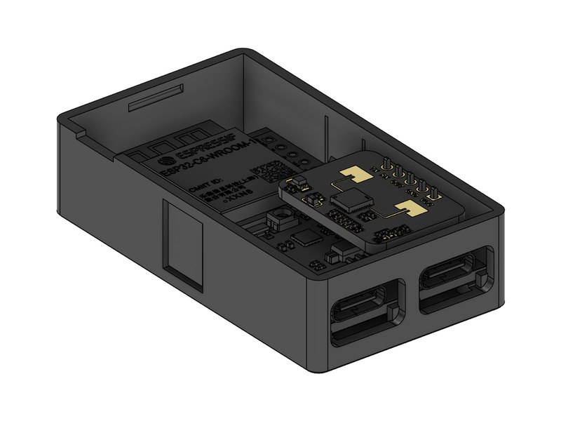
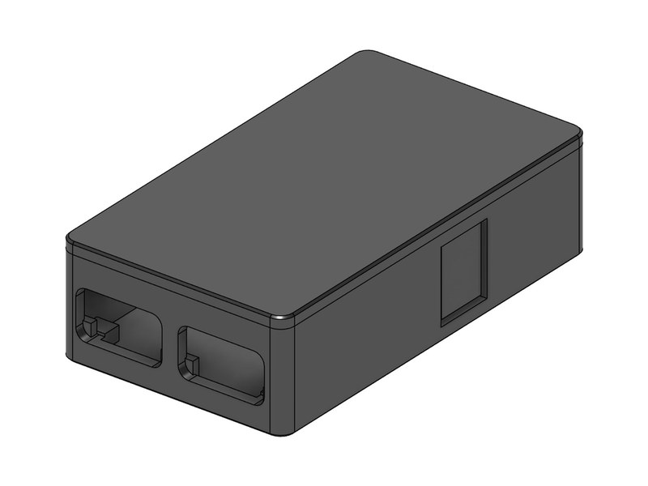
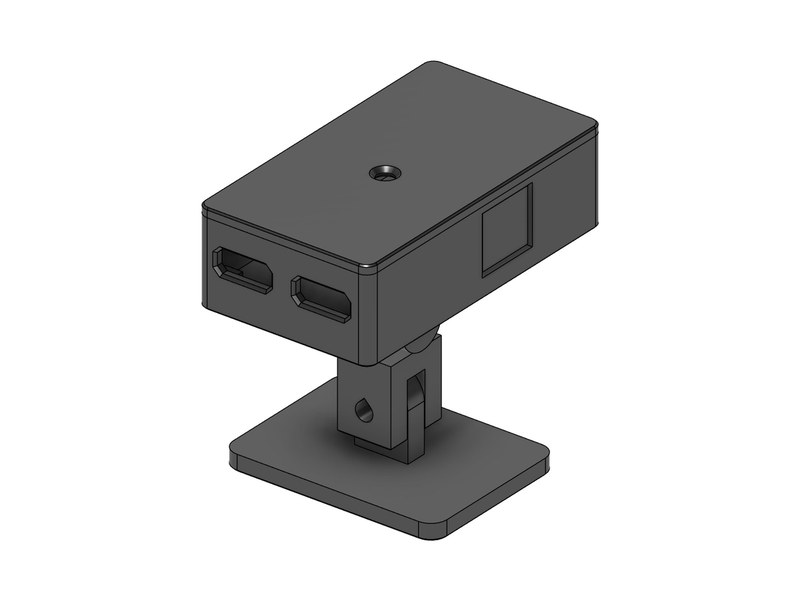
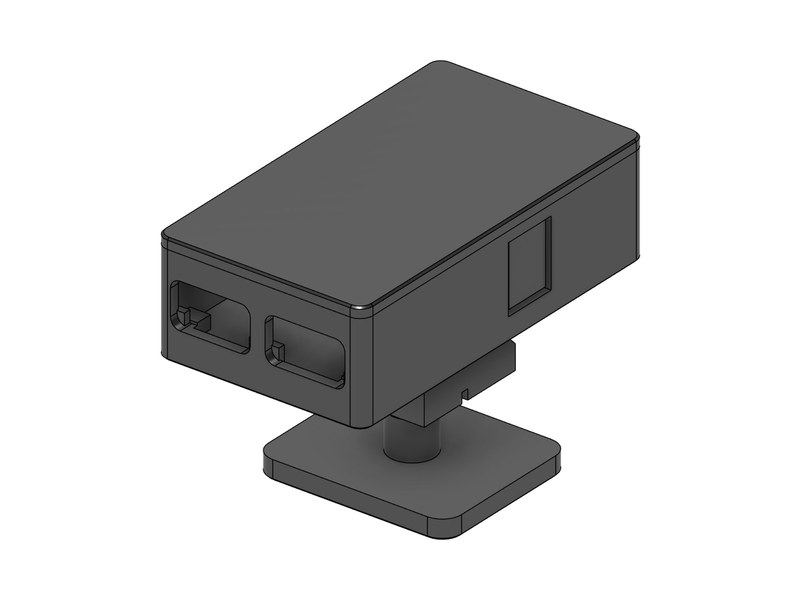

# mmWave presence sensor · HLK-LD2410C + nanoESP32-C6

*[Versión en español más abajo](#espanol)*

Human presence sensor for Home Assistant built from an **HLK-LD2410C** mmWave radar plugged straight into a **nanoESP32-C6** (no soldering, no wires), running **ESPHome**, with a 3D-printed enclosure (and optional wall mounts).

<p align="center">
  
  
</p>

## Hardware

| Component | Notes |
|---|---|
| nanoESP32-C6 | Dual USB-C board (silkscreen "nanoESP32-C6 V1.0", ESP32-C6-WROOM-1 module) |
| HLK-LD2410C | 24 GHz mmWave radar |
| USB-C cable + 5 V power supply | |

### Wiring

The radar's pins go straight into the ESP header holes, no wires. Nothing needs soldering: a rib inside the case pushes the radar sideways so its pins press against the holes. You can still solder them if you prefer.

| LD2410C | nanoESP32-C6 | Use |
|---|---|---|
| VCC | 5V | Power |
| GND | GND | |
| OUT | GPIO9 | Not used (GPIO9 is a C6 strapping pin) |
| RX | GPIO18 | ESP TX |
| TX | GPIO19 | ESP RX |

All data comes over UART at 256000 baud.

<p align="center"></p>

## Firmware (ESPHome)

There are two configurations:

| File | Link to Home Assistant |
|---|---|
| [`sensor-presencia.yaml`](sensor-presencia.yaml) | **Zigbee** (Zigbee2MQTT), no WiFi |
| [`sensor-presencia-wifi.yaml`](sensor-presencia-wifi.yaml) | **WiFi** + native ESPHome API |

**Zigbee version.** The ESP32-C6 runs as a Zigbee **router**, so it also strengthens the mesh. Only `binary_sensor`, `sensor`, `switch` and `number` entities go over Zigbee, so the radar's `select` and `button` entities are internal and driven through "bridge" switches. Entity names are ASCII-only because Zigbee requires it.

The firmware is deliberately small: with too many endpoints, Zigbee2MQTT's configure step overflows the ESP's binding table. Every entity uses `report: force`, and states and readings are re-sent on join and every 5 minutes, so nothing gets stuck if a message is lost.

**WiFi version.** Copy `secrets.yaml.example` to `secrets.yaml` and fill in your values.

Flash over USB:

```bash
esphome run sensor-presencia.yaml --device COMx
```

### Main entities (Zigbee version)

Entity names are in Spanish.

- Presence (occupancy), moving and still presence
- Detection distance, moving and still distances and energies
- Light level in % (the LD2410C's light sensor, not lux)
- Radar settings: timeout, max moving and still gates, 20 cm distance resolution, Bluetooth
- Radar restart and factory reset, parameter readout, ESP restart

The WiFi version also exposes the OUT pin, light threshold and function, baud rate, radar firmware and MAC.

### Calibration

Per-gate sensitivity (G0–G8) is tuned with Hi-Link's **HLKRadarTool** app over Bluetooth (the radar's Bluetooth is on by default; it can be toggled with the **Bluetooth radar** switch). The settings are stored in the radar itself and survive reflashing the ESP. Afterwards, turn on **Leer parametros** so Home Assistant picks up any changed timeout or max gates.

With the room **empty**, set each gate's threshold a little above the highest energy you see there (about 5–10 points). Then check that you are still detected when sitting still where you usually are.

Factory thresholds (firmware 2.44, 0.75 m per gate):

| Gate | G0 | G1 | G2 | G3 | G4 | G5 | G6 | G7 | G8 |
|---|---|---|---|---|---|---|---|---|---|
| Moving | 50 | 50 | 40 | 30 | 20 | 15 | 15 | 15 | 15 |
| Still | — | — | 40 | 40 | 30 | 30 | 20 | 20 | 20 |

## 3D-printed enclosure

Three versions, designed for FDM printing (Bambu Lab X1C, 0.4 mm nozzle, ABS) and printed at 100 % scale. Print settings and supports come set up in the 3MF; only the case needs supports.

| Version | | Download |
|---|---|---|
| **Compact enclosure** (32 × 57 × 16 mm). Snap-fit lid, clip-held PCB, window over the light sensor. |  | [MakerWorld](https://makerworld.com/en/models/3617293-esp32-c6-ld2410c-presence-sensor-no-soldering) |
| **Dual-hinge wall mount.** Pan and tilt, locks with 2 × M3. |  | MakerWorld *(link coming soon)* |
| **Ball-joint wall mount.** ±35° plus 360° rotation, locks with 1 × M3. |  | [MakerWorld](https://makerworld.com/en/models/3617293-esp32-c6-ld2410c-presence-sensor-no-soldering) |

Printable files (STL and 3MF) are published on [MakerWorld](https://makerworld.com/en/models/3617293-esp32-c6-ld2410c-presence-sensor-no-soldering) only.

## License

Firmware and documentation under the [MIT](LICENSE) license. 3D models are licensed as stated on MakerWorld.

---

<a name="espanol"></a>
# Sensor de presencia mmWave · HLK-LD2410C + nanoESP32-C6

Sensor de presencia humana para Home Assistant basado en el radar mmWave **HLK-LD2410C** pinchado directamente en una **nanoESP32-C6** (sin soldar y sin cables), con firmware **ESPHome** y caja impresa en 3D (con soportes de pared opcionales).

## Hardware

| Componente | Notas |
|---|---|
| nanoESP32-C6 | Placa con dos USB-C (serigrafía «nanoESP32-C6 V1.0», módulo ESP32-C6-WROOM-1) |
| HLK-LD2410C | Radar mmWave de 24 GHz |
| Cable USB-C + alimentador 5 V | |

### Conexión

Los pines del radar entran directamente en los taladros del ESP, sin cables. No hay que soldar: un nervio dentro de la caja empuja el radar de lado para que los pines apoyen contra los taladros. Si lo prefieres, puedes soldarlos igualmente.

| LD2410C | nanoESP32-C6 | Uso |
|---|---|---|
| VCC | 5V | Alimentación |
| GND | GND | |
| OUT | GPIO9 | No se usa (GPIO9 es pin de arranque del C6) |
| RX | GPIO18 | TX del ESP |
| TX | GPIO19 | RX del ESP |

Toda la información llega por UART a 256000 baudios.

<p align="center"></p>

## Firmware (ESPHome)

Hay dos configuraciones:

| Archivo | Conexión con Home Assistant |
|---|---|
| [`sensor-presencia.yaml`](sensor-presencia.yaml) | **Zigbee** (Zigbee2MQTT), sin WiFi |
| [`sensor-presencia-wifi.yaml`](sensor-presencia-wifi.yaml) | **WiFi** + API nativa de ESPHome |

**Versión Zigbee.** El ESP32-C6 funciona como **router** Zigbee, así que además refuerza la malla. Por Zigbee solo viajan entidades `binary_sensor`, `sensor`, `switch` y `number`, así que los `select` y `button` del radar quedan internos y se manejan con interruptores «puente». Los nombres van sin tildes porque Zigbee solo admite ASCII.

El firmware es reducido a propósito: con demasiados endpoints, el «configure» de Zigbee2MQTT llena la tabla de bindings del ESP. Todas las entidades llevan `report: force`, y los estados y lecturas se reenvían al unirse y cada 5 minutos, para que nada se quede atascado si se pierde un mensaje.

**Versión WiFi.** Copia `secrets.yaml.example` como `secrets.yaml` y rellena tus datos.

Para compilar y flashear por USB:

```bash
esphome run sensor-presencia.yaml --device COMx
```

### Entidades principales (versión Zigbee)

- Presencia (ocupación), movimiento y presencia estática
- Distancia de detección, distancias y energías de movimiento y estáticas
- Luz en % (el sensor de luz del LD2410C, no son lux)
- Ajustes del radar: tiempo de espera, puertas máximas de movimiento y estática, resolución de 20 cm, Bluetooth
- Reinicio y reset de fábrica del radar, lectura de parámetros, reinicio del ESP

La versión WiFi expone además el pin OUT, el umbral y la función de luz, la velocidad del UART, el firmware y la MAC del radar.

### Calibración

La sensibilidad por puertas (G0–G8) se ajusta con la app **HLKRadarTool** de Hi-Link por Bluetooth (el Bluetooth del radar viene encendido; se puede activar o apagar con el interruptor **Bluetooth radar**). Los ajustes se guardan en el propio radar y no se pierden al reflashear el ESP. Al terminar, activa **Leer parametros** para que Home Assistant recoja el tiempo de espera o las puertas máximas si los has cambiado.

Con la habitación **vacía**, pon el umbral de cada puerta un poco por encima de la energía más alta que veas en ella (unos 5–10 puntos). Después comprueba que te sigue detectando estando quieto en tu sitio habitual.

Umbrales de fábrica (firmware 2.44, 0,75 m por puerta):

| Puerta | G0 | G1 | G2 | G3 | G4 | G5 | G6 | G7 | G8 |
|---|---|---|---|---|---|---|---|---|---|
| Movimiento | 50 | 50 | 40 | 30 | 20 | 15 | 15 | 15 | 15 |
| Estático | — | — | 40 | 40 | 30 | 30 | 20 | 20 | 20 |

## Caja impresa en 3D

Tres versiones, diseñadas para impresión FDM (Bambu Lab X1C, boquilla 0,4 mm, ABS) e impresas al 100 %. Los ajustes de impresión y los soportes vienen configurados en el 3MF; solo la caja lleva soportes.

| Versión | | Descarga |
|---|---|---|
| **Caja compacta** (32 × 57 × 16 mm). Tapa con clic, placa sujeta con clips y ventana sobre el sensor de luz. |  | [MakerWorld](https://makerworld.com/es/models/3617293-esp32-c6-ld2410c-presence-sensor-no-soldering) |
| **Soporte de pared de doble bisagra.** Giro e inclinación, bloqueo con 2 × M3. |  | MakerWorld *(enlace pendiente)* |
| **Soporte de pared de rótula.** ±35° y giro de 360°, bloqueo con 1 × M3. |  | [MakerWorld](https://makerworld.com/es/models/3617293-esp32-c6-ld2410c-presence-sensor-no-soldering) |

Los archivos para imprimir (STL y 3MF) solo se publican en [MakerWorld](https://makerworld.com/es/models/3617293-esp32-c6-ld2410c-presence-sensor-no-soldering).

## Licencia

Firmware y documentación bajo licencia [MIT](LICENSE). Los modelos 3D se rigen por la licencia indicada en MakerWorld.
